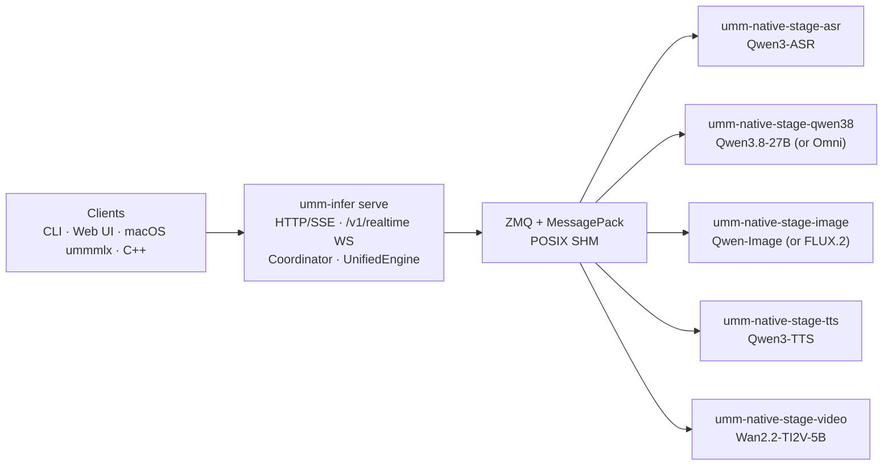

# ummInfer

A native C++20/CUDA inference engine for unified multimodal models. ummInfer exposes an OpenAI-compatible HTTP/SSE API (`/v1/chat/completions`, `/v1/audio/*`, `/v1/images/*`, `/v1/videos`, `/v1/visual/render`) and a full-duplex WebSocket voice API (`/v1/realtime`), orchestrating isolated per-GPU native C++/CUDA model stages over ZeroMQ + MessagePack + POSIX shared memory.

The default native serving path loads no Python, PyTorch, vLLM, or SGLang runtime.

## Highlights

- **Five-modality native execution**: ASR, VLM (text + image + video input), Image, streaming TTS (with zero-shot voice cloning), and native T2V / first-frame-anchored I2V Video.
- **Interleaved multimodal output**: Stream structured text, inline images, videos, and sentence-level PCM16 speech in one response, with in-place image-to-video animation (`POST /v1/visual/render`).
- **Full-duplex voice (`/v1/realtime`)**: Streaming audio input, server VAD, barge-in cancellation, and playback-acknowledged conversation history.
- **Clients included**: `umm-infer` CLI & C++ client, single-file browser UI (`web/index.html`), and native macOS SwiftUI client (`clients/ummmlx`).

## Architecture



Each stage runs one model on one GPU (`kSerial` by default; `qwen38` supports opt-in continuous batching via `--batch-size N`). `/ready` returns `200` once the entry and VLM stages register; optional output legs never gate readiness.

## Supported models

| Modality | Model | Backend | Notes |
| --- | --- | --- | --- |
| ASR | Qwen3-ASR 0.6B / 1.7B | `native/umm_asr_native` | 16 kHz mono PCM16, up to 30 s |
| VLM | Qwen3.8-27B (default) | `native/qwen38` | Text, image, native video input (`4/8/16` frame budgets), prefix KV reuse, `--batch-size N` |
| VLM (opt.) | Qwen3-Omni thinker | `native/omni` | MoE thinker, pure-text prefix cache |
| Speech | Qwen3-TTS 0.6B / 1.7B CustomVoice & 1.7B-Base | `native/tts` | Streaming 24 kHz PCM16 / WAV, native ECAPA-TDNN zero-shot cloning |
| Image | Qwen-Image-2512 / 2.1 | `native/image`, `native/image2` | 512×512 PNG (`--image-backend 2512\|2.1`) |
| Image (opt.) | FLUX.2-klein-4B | `python/umminfer_flux2_stage.py` | Optional Python/Diffusers stage; 512²/1024² + image editing |
| Video | Wan2.2-TI2V-5B | `native/video` | Native CUDA T2V & first-frame-anchored I2V (H.264 MP4) |

Full hardware footprints, licenses, and verification status: [docs/model-support.md](docs/model-support.md).

## Quick start

### 1. Build

```sh
# Server, CLI, and C++ client (Zig 0.16.0)
zig build -Doptimize=ReleaseFast \
  -Ddeps-prefix=/opt/homebrew -Dcurl-prefix=/opt/homebrew/opt/curl

# Native CUDA stages (Linux + CUDA host)
cmake -S native/stage_cli -B build -DUMM_STAGE_CUDA=ON -DCMAKE_BUILD_TYPE=Release
cmake --build build -j
```

*(Pass `-DCMAKE_PREFIX_PATH=/path/to/deps` if `zmq`, `msgpack`, `nlohmann-json`, or `ICU` are in a custom prefix.)*

### 2. Run

Launch the multi-stage stack via the supervisor or service script (see [docs/native-service.md](docs/native-service.md)):

```sh
python3 -I python/umminfer_service.py --config service/native-service.json start
# or: service/native-service.sh start|stop|status
```

### 3. Call

```sh
curl -sS http://127.0.0.1:43301/v1/chat/completions \
  -H 'Content-Type: application/json' \
  -d '{"model":"qwen3-native","messages":[{"role":"user","content":"What is the sea?"}]}'
```

## Tests

```sh
# Control plane, API contracts, voice client, and deterministic suites (CPU-only)
zig build test -Ddeps-prefix=/opt/homebrew -Dcurl-prefix=/opt/homebrew/opt/curl

# Native stage host tests (CPU-only, no weights or GPU required)
cmake -S native/stage_cli -B build-host && cmake --build build-host -j
ctest --test-dir build-host --output-on-failure
```

## Layout

```text
build.zig             server, CLI, C++ client, and contract tests
include/  src/        C++20 control plane, UnifiedEngine, HTTP/SSE/WS, clients
native/               C++/CUDA model engines (asr, qwen38, omni, tts, image, image2, video, stage_cli)
web/                  single-file browser client (index.html)
clients/ummmlx/       native macOS SwiftUI client
service/              SM90 launcher and supervisor config
python/               process supervisor, optional FLUX.2/MLX stages, offline RL tooling
tests/  benchmarks/   C++/Python E2E, live gates, and multimodal benchmarks
docs/                 vision, architecture, feature map, contracts, and runbooks
```

## Known limitations

- **Single-GPU per stage**: No multi-GPU tensor splitting; decode continuous batching (`--batch-size N`) is implemented for `qwen38` only ([docs/batching.md](docs/batching.md)).
- **Input bounds**: Native VLM accepts `data:` URLs and local paths (not remote `http(s)` URLs); ASR accepts 16 kHz mono PCM16 up to 30 s.
- **Optional Python stages**: `FLUX.2-klein-4B` runs via Python/Diffusers rather than native C++/CUDA; native image stages (`2512`/`2.1`) do not yet support image-to-image editing.
- **CUDA IPC**: Currently transports host-serialized bytes; zero-copy device-tensor IPC and multi-host IPC are `NOT_COVERED` ([docs/cuda-ipc.md](docs/cuda-ipc.md)).
- **Realtime & video quality gates**: High-concurrency delayed-reader realtime backpressure and natural-video understanding are actively being hardened; perceptual/human quality evaluation remains `NOT_RUN` ([docs/roadmap.md](docs/roadmap.md)).

## Documentation

- **Vision & roadmap**: [docs/vision.md](docs/vision.md) · [docs/north-star-cases.md](docs/north-star-cases.md) · [docs/roadmap.md](docs/roadmap.md)
- **Architecture & code map**: [docs/architecture.md](docs/architecture.md) · [docs/feature-map.md](docs/feature-map.md) · [docs/model-support.md](docs/model-support.md)
- **Protocols**: [docs/mixed-output-contract.md](docs/mixed-output-contract.md) · [docs/full-duplex.md](docs/full-duplex.md) · [native/STAGE_NATIVE.md](native/STAGE_NATIVE.md)
- **Operations & clients**: [docs/native-service.md](docs/native-service.md) · [docs/observability.md](docs/observability.md) · [docs/client.md](docs/client.md) · [web/README.md](web/README.md) · [clients/ummmlx/README.md](clients/ummmlx/README.md)
- **Training boundary**: [docs/rl.md](docs/rl.md) · [docs/rl-phase2.md](docs/rl-phase2.md)

## License

Licensed under Apache-2.0. Third-party notices are listed in [native/THIRD_PARTY_NOTICES.md](native/THIRD_PARTY_NOTICES.md).
