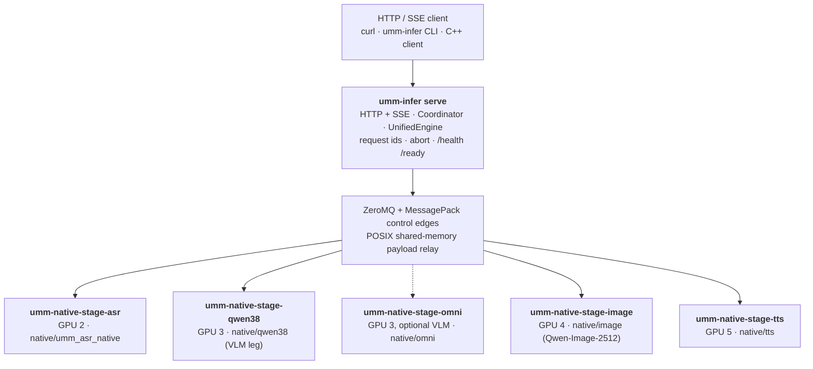

# ummInfer

ummInfer is an inference runtime for unified multimodal models. A C++20 control
plane serves an OpenAI-compatible HTTP/SSE surface and drives one native
C++/CUDA model executor per GPU as an external stage process. No Python,
PyTorch, vLLM or SGLang is loaded on the serving path; `ldd` on every stage
binary lists the CUDA runtime, libzmq, libmsgpackc and system libraries only.

## Architecture



One request runs an ordered plan: optional ASR, then the VLM leg, then the
optional image and TTS output legs. Every stage registers with the existing
`Stage::Config` contract (`recv`, `coordinator`, `abort`, `announce_ready`).
Each process loads one model on one GPU and handles one request at a time.
Exactly one VLM stage runs at a time: `vlm_stage` in the service config picks
`qwen38` (default) or `omni`.

| Path | Stages | Terminal |
| --- | --- | --- |
| Text chat | VLM | `complete`; qwen38 also emits one `vlm_delta` per token |
| Audio -> text | ASR -> VLM | `asr_final`, then VLM deltas, then `complete` |
| Image + text -> text | VLM | `complete` |
| Text -> speech | VLM -> TTS | `complete` with one `artifact` (WAV) |
| Text -> image | VLM -> image | `complete` with one `artifact` (PNG) |
| Text + image + audio -> text + image + audio | ASR -> VLM -> image ∥ TTS | `complete` with two `artifact`s |

## Quick start

Build the server (Zig 0.16.0). The native stage executables are a separate
CMake project and need a CUDA host.

```sh
zig build -Doptimize=ReleaseFast \
  -Ddeps-prefix=/opt/homebrew -Dcurl-prefix=/opt/homebrew/opt/curl

cmake -S native/stage_cli -B build -DUMM_STAGE_CUDA=ON -DCMAKE_BUILD_TYPE=Release
cmake --build build -j
```

Add `-DCMAKE_PREFIX_PATH=/path/to/deps` when zmq, msgpack, nlohmann-json or ICU
are outside the default include and library paths.

Start the server and one stage per model. The server queues requests until a
stage announces readiness; `/ready` answers 200 after the entry and VLM stages
are ready, and the optional image/TTS legs never gate it.

```sh
IPC=$(mktemp -d /tmp/umminfer-native.XXXXXX)

./zig-out/bin/umm-infer serve --host 127.0.0.1 --port 43301 --model qwen3-native \
  --entry asr --entry-endpoint "ipc://$IPC/asr" \
  --vlm-entry qwen38 --vlm-entry-endpoint "ipc://$IPC/qwen38" \
  --image-entry image --image-entry-endpoint "ipc://$IPC/image" \
  --tts-entry tts --tts-entry-endpoint "ipc://$IPC/tts" \
  --completion "ipc://$IPC/completion" --abort "ipc://$IPC/abort"

build/umm-native-stage-asr --kind asr --name asr --model "$ASR_MODEL" --gpu 2 \
  --recv-endpoint "ipc://$IPC/asr" --coordinator-endpoint "ipc://$IPC/completion" \
  --abort-endpoint "ipc://$IPC/abort"

build/umm-native-stage-qwen38 --kind qwen38 --name qwen38 \
  --model "$QWEN38_MODEL" --gpu 3 --max-new-tokens 96 \
  --recv-endpoint "ipc://$IPC/qwen38" --coordinator-endpoint "ipc://$IPC/completion" \
  --abort-endpoint "ipc://$IPC/abort"

# Optional output legs.
build/umm-native-stage-image --kind image --name image --model "$IMAGE_MODEL" --gpu 4 \
  --recv-endpoint "ipc://$IPC/image" --coordinator-endpoint "ipc://$IPC/completion" \
  --abort-endpoint "ipc://$IPC/abort"
build/umm-native-stage-tts --kind tts --name tts --model "$TTS_MODEL" --gpu 5 \
  --recv-endpoint "ipc://$IPC/tts" --coordinator-endpoint "ipc://$IPC/completion" \
  --abort-endpoint "ipc://$IPC/abort"
```

One request:

```sh
curl -sS http://127.0.0.1:43301/v1/chat/completions \
  -H 'Content-Type: application/json' \
  -d '{"model":"qwen3-native","messages":[{"role":"user",
       "content":"What is the sea?"}]}'
```

Recorded response from the native Omni stage (abridged;
`native/stage_tests/evidence/resident/vlm_text.json`, HTTP 200 in 38.2 s). The
Qwen3.8-27B stage returns the same JSON shape with a different answer:

```json
{"choices":[{"finish_reason":"stop","index":0,"message":{
  "content":"The sea is a vast, ever-changing expanse of saltwater that stretches to the horizon.",
  "role":"assistant"}}],"id":"req-2","model":"qwen3-native",
 "object":"chat.completion"}
```

Transcription:

```sh
curl -sS -F model=qwen3-native -F file=@input_16k.wav \
  http://127.0.0.1:43301/v1/audio/transcriptions
```

On H20B the same layout is launched by
`service/h20b-native-service.sh start|stop|status`, configured by
`service/h20b-service.json`. Set `UMM_NATIVE_OMNI=1` to serve Omni instead of
Qwen3.8-27B as the VLM leg.

## Supported models

Measured on H20B, BF16, greedy decoding, one request in flight. Each engine's
own document has the full conditions and limits.

| Model | Native implementation | GPU | Measured |
| --- | --- | --- | --- |
| Qwen3-ASR 0.6B | `native/umm_asr_native` | 2 | 15.05 s clip -> 46 tokens in ~1.0 s after model load (4.8 s) |
| Qwen3.8-27B (hybrid linear/full attention) | `native/qwen38` | 3 | text: 0.16 s prefill, 42.0 tok/s; 512x512 image: 1.05 s prefill, 29.2 tok/s |
| Qwen3-Omni thinker (MoE, 57.87 GiB), optional | `native/omni` | 3 | image case: vision 0.363 s, prefill 0.231 s, decode 30.6 tok/s; text case 14.79 ms/token after the MoE host-path fix |
| Qwen3-TTS 0.6B CustomVoice | `native/tts` | 5 | 4.24 s speech in 7.2 s after the codec-conv fix (29.1 s before) |
| Qwen-Image-2512 | `native/image` | 4 | 512x512, 50 steps: 228.8 s (runs: 227.5-229.5 s) |
| Qwen-Image-2.1 | `native/image2` | 7 | 512x512, 40 steps: 69.8 s, peak 14,763 MiB |

Qwen3.8-27B is the default VLM stage. It has a text decoder and a vision tower
but no audio tower: audio and video parts, more than one image, `http(s)` image
URLs and `modalities` containing `audio` are rejected with an error that names
the field. ASR, Omni and TTS answers are greedy and deterministic.

## Layout

```text
build.zig                       server, client, CLI, C++ contract tests
include/umminfer/               public C++ headers (client, proto, relay, serve)
src/                            server: coordinator, unified engine, HTTP/SSE, CLI
native/umm_asr_native/          Qwen3-ASR engine + CLI + host/GPU tests
native/omni/  native/omni_cli/  Qwen3-Omni thinker engine + CLI + bench
native/qwen38/                  Qwen3.8-27B executor + CLI
native/tts/   native/tts_cli/   Qwen3-TTS engine + CLI
native/image/ native/image_cli/ Qwen-Image-2512 engine + CLI
native/image2/                  Qwen-Image-2.1 engine + CLI
native/stage_cli/               the five umm-native-stage-* binaries
native/stage_tests/             live smoke harness + committed evidence
service/                        H20B launcher and supervisor config
tests/                          C++ contract tests, Python E2E, CUDA tests
python/                         offline/legacy: MLX stage, RL tooling, old Qwen
                                SGLang workers (not on the serving path)
docs/                           roadmap, validation, contracts, case records
```

`native/omni`, `native/tts`, `native/image`, `native/image2` and
`native/stage_cli` each have their own CMake project. Qwen3.8-27B builds from
`native/CMakeLists.txt` with `-DUMM_QWEN38_CUDA=ON`. `native/stage_cli` links
the accepted engine trees without modifying them.

## Tests and validation

Server and control plane (CPU, no model, no CUDA):

```sh
zig build test -Ddeps-prefix=/opt/homebrew -Dcurl-prefix=/opt/homebrew/opt/curl
```

This builds and runs `self_check`, `wire_compat`, `runtime_compat`,
`omni_transport_test`, `unified_contract_test`, `omni_serve_test` and
`omni_client_test`. Two consecutive runs on this Mac (Zig 0.16.0, Homebrew
deps) exited 0 and printed `all 112 client checks passed`, `all transport
checks passed` and `all serve proxy checks passed`. An earlier run on commit
`31cf1fd` failed `omni_client_test` with `SimpleScheduler: batch collection
failed: cost failed`, so a non-zero exit is a real failure, not a known state.

Host tests that need no weights and no GPU:

```sh
cmake -S native/omni -B native/omni/build && cmake --build native/omni/build -j
ctest --test-dir native/omni/build

cmake -S native/stage_cli -B build-host && cmake --build build-host
ctest --test-dir build-host
```

`native/tts`, `native/image`, `native/image2` and the Qwen3.8-27B project have
their own host targets with the same shape. GPU parity and kernel tests run on
the CUDA host, one project at a time, as `ctest` in each build directory. Gate
values, golden-data provenance and known gaps are in each executor's document.

End-to-end smoke against a running deployment:

```sh
python3 -I native/stage_tests/native_stage_smoke.py \
  --base-url http://127.0.0.1:43301 \
  --wav asr_en_pcm16.wav --image man_ironing.png \
  --out-dir ./smoke-out
```

The committed record of that harness (health, direct ASR, text and image VLM,
audio->text SSE, mixed text+image+audio, TTS round-trip, cancellation paths,
recovery) is
[native/stage_tests/evidence/MANIFEST.md](native/stage_tests/evidence/MANIFEST.md).

Full request-level reproduction of a four-stage deployment:

```sh
SSH_OPTS="-o ControlPath=$HOME/.ssh/cm/tn-h20b" sh docs/cases/0001_repro.sh
```

Case record, per-leg timings and hashes: [docs/cases/0001-end-to-end-native.md](docs/cases/0001-end-to-end-native.md).

CUDA IPC remains separately testable:

```sh
zig build test -Dcuda -Dcuda-prefix=/usr/local/cuda -Ddeps-prefix=/opt/homebrew
zig build cuda-stress -Dcuda -Dcuda-prefix=/usr/local/cuda -Ddeps-prefix=/opt/homebrew
zig build cuda-bench -Dcuda -Dcuda-prefix=/usr/local/cuda -Ddeps-prefix=/opt/homebrew -Doptimize=ReleaseFast
```

## Known limitations

- One request at a time per stage. There is no continuous batching, no
  multi-request scheduler, and no multi-GPU model split.
- Request `params` do not reach a C++ stage compute function: `max_tokens`,
  `temperature` and `stream` are ignored by the stage, which uses its configured
  cap. The H20B launcher sets the VLM stage to 96 tokens.
- The Omni stage returns one aggregated answer. The Qwen3.8-27B stage streams
  one delta per generated token; both keep the same aggregated terminal result.
- All native executors are greedy and deterministic. Sampling, beam search and
  repetition controls are not implemented.
- ASR accepts 16 kHz mono PCM16 only, at most 30 s per request.
- Qwen3.8-27B accepts one still image per request and `max_seq` 8192.
- Image output is 512x512 PNG only. Qwen-Image-2512 defaults to 512x512
  (official default 1024x1024); Qwen-Image-2.1 has no true CFG, no KV cache and
  no condition-image editing.
- TTS has two fixed voice presets (`vivian`, `ryan`), Chinese and English.
  Repeated runs differ by sub-LSB PCM16 amounts; waveforms are not bit-exact.
- Mixed output requires `stream=true`. A non-streaming request with `image` or
  `audio` output is rejected with HTTP 400.
- The image stage loads its weights on the first request after start (about
  9.5 s, +11 GiB), so the first render is slower than steady state.
- Model revisions are `UNKNOWN`; the local model directories carry no `.git`.
- CUDA IPC carries host-serialized payload bytes, not device tensors. CUDA relay
  under real model load, zero-copy transfer and multi-host IPC are `NOT_COVERED`.
- Native VLM stages reject `http(s)` image URLs; they accept `data:` URLs and
  local paths only.

## Documentation

| Document | Contents |
| --- | --- |
| [native/STAGE_NATIVE.md](native/STAGE_NATIVE.md) | Stage binaries, wire shapes, streaming, cancellation |
| [native/OMNI_NATIVE.md](native/OMNI_NATIVE.md) | Omni engine, matmul kernels, prefill/decode measurements |
| [native/qwen38/README.md](native/qwen38/README.md) | Qwen3.8-27B architecture, parity harness, limits |
| [native/TTS_NATIVE.md](native/TTS_NATIVE.md) | TTS engine, codec, determinism and evidence |
| [native/IMAGE_NATIVE.md](native/IMAGE_NATIVE.md) | Qwen-Image-2512 pipeline and verification |
| [native/image2/IMAGE2_NATIVE.md](native/image2/IMAGE2_NATIVE.md) | Qwen-Image-2.1 pipeline, parity, performance |
| [docs/gpu-utilization.md](docs/gpu-utilization.md) | Measured GPU busy fraction, bandwidth, kernel hotspots |
| [docs/validation.md](docs/validation.md) | User journeys, H20B runs, what remains `NOT_COVERED` |
| [docs/roadmap.md](docs/roadmap.md) | Phases, acceptance gates, verification split |
| [docs/cases/0001-end-to-end-native.md](docs/cases/0001-end-to-end-native.md) | One recorded end-to-end request with hashes and timings |
| [docs/mixed-output-contract.md](docs/mixed-output-contract.md) | Frozen text+image+audio request and event contract |
| [docs/external_stage.md](docs/external_stage.md) | Stage protocol, relay, CUDA IPC |
| [docs/cuda-ipc.md](docs/cuda-ipc.md) | CUDA IPC build and fallback rules |
| [docs/h20b-service.md](docs/h20b-service.md) | Historical H20B service runbook and topology |
| [docs/benchmark-system.md](docs/benchmark-system.md) | Benchmark datasets, metrics, stability gate |
| [docs/client.md](docs/client.md) | C++ client and CLI |
| [docs/mlx.md](docs/mlx.md) | MLX text backend (legacy local path) |
| [docs/performance-baseline.md](docs/performance-baseline.md) | Historical unified performance baseline |
| [docs/joint-optimization.md](docs/joint-optimization.md) | Worker-concurrency optimization record |
| [docs/rl-phase2.md](docs/rl-phase2.md) | RL rollout/reward/optimizer-step validation |

Licensed under Apache-2.0. Third-party derivations are listed in
[native/THIRD_PARTY_NOTICES.md](native/THIRD_PARTY_NOTICES.md) and each
executor's `NOTICE`.
