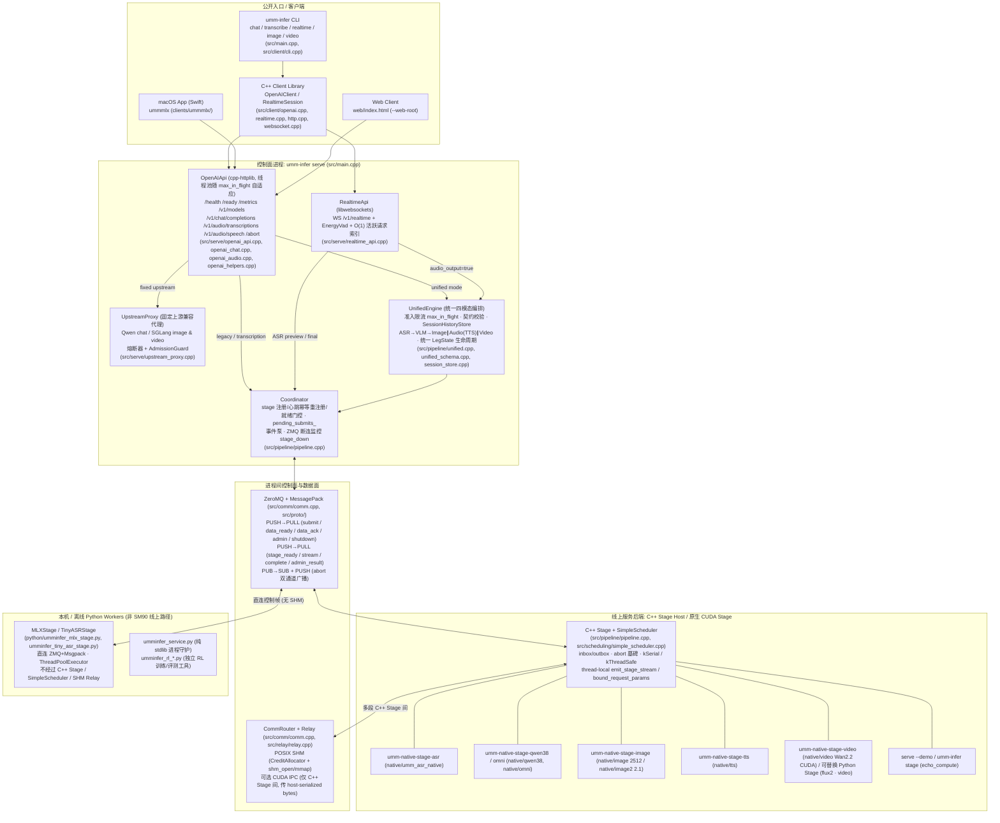

# ummInfer 权威架构与验证说明

> 本文档是 ummInfer 的单一权威架构文档，涵盖真实源码核对后的系统拓扑、端到端调用链（同步/流式、取消、错误、会话与资源生命周期）、本机轻量验证矩阵以及已记录的技术债边界。
> 代码锚点索引见 [docs/feature-map.md](feature-map.md)；模型支持矩阵与选型见 [docs/model-support.md](model-support.md)；阶段门控与规划见 [docs/roadmap.md](roadmap.md)。

---

## 1. 整体架构图

---

## 2. 关键调用链与生命周期

| 维度 | 真实代码路径与行为 | 关键源码定位 |
|---|---|---|
| **同步请求（非流式）** | `POST /v1/chat/completions` (`stream=false`) → 校验通过后 `submit_chat()` 调 `UnifiedEngine::submit()`（无音频直投 `vlm_stage`，有音频先投 `asr_stage`）或 `Coordinator::submit()`（分配 `req-N`）→ `while (!settled && !req.is_connection_closed()) wait_chat(id, 0.1)` 轮询等待 → `release_chat(id)` 清理记录并返回 JSON；带可选多模态输出时由 `handle_nonstream_mixed()` 收集统一产物事件（单片直编码、多片预分配拼装）并返回含 `artifacts`/`legs` 的 JSON。`/v1/audio/transcriptions` 绕过 `UnifiedEngine` 直接走 `Coordinator::submit(..., entry_stage)`；`/v1/audio/speech` 复用 `UnifiedEngine::tts_stage_name()` 注册的 TTS stage，经 `AdmissionGuard` 准入后同步返回 `audio/wav` 或 `audio/pcm`（未注册 TTS stage 或固定上游模式返回 501）。 | `src/serve/openai_chat.cpp:46-203`, `454-518`; `src/serve/openai_audio.cpp:18-385`; `src/pipeline/unified.cpp:183-260` |
| **流式请求（SSE / WS）** | **HTTP SSE**：`OpenAIApi` 按 `max_in_flight` 配置 `cpp-httplib` 线程池并分配 `http-N` 注册 `SseSink` → `set_chunked_content_provider` 消费 `SseSink::pop()`。`Coordinator::run()` 单线程泵收到 `StreamMessage`/`CompleteMessage` → `UnifiedEngine::CallbackGate` → `handle_stream`/`handle_complete` 入 `dispatch_queue_` 串行化派发（避免重入死锁）→ `on_event` 推送到 `SseSink`。文本/图像/音频/视频共用统一 `UnifiedModality` 与 `LegState`（`pending`/`running`/`completed`/`failed`/`aborted`，可通过 `legs_snapshot()` 查询），图像（`image/png`/`jpeg`）、音频（`audio/wav`/`pcm`）与视频（`video/mp4`，单产物上限 48 MiB、单请求聚合上限 60 MiB）产物统一经 `slice_artifact_events` 按 `2 MiB` 分片并在 HTTP provider 线程做 base64 与末片 SHA-256。**流式 TTS**：`audio.stream=true` 且无 image/video 输出时，`handle_stream` 在 VLM delta 到达时调用 `drain_sentences_locked`（带异常保护，提交失败转为 `kLegError` 而不中断 VLM 或事件泵）按句切分（首句 8 codepoints，后续 48 codepoints，最多 32 个子 leg `id:tts:N`）边生成边推 `audio/pcm` `kArtifact`。**WebSocket**：`RealtimeApi` 在 `libwebsockets` 线程每 10ms `poll_sessions()` 消费 `partial_queue_`（经 `active_request_sessions_` `O(1)` 查找归属会话）与 `unified_queue_`，VAD 触发 `speech_started`/`speech_stopped`，`audio_output=true` 时把转写结果交给 `UnifiedEngine`。 | `src/serve/openai_api.cpp:29-56`, `334-424`; `src/serve/openai_chat.cpp:520-695`; `src/pipeline/unified.cpp:459-610`, `1007-1110`; `src/pipeline/unified_schema.cpp:358-420`; `src/serve/realtime_api.cpp:238-270`, `861-1150` |
| **取消与中止** | **触发源**：客户端断连（`req.is_connection_closed()` / `!out_sink.is_writable()` / WS `LWS_CALLBACK_CLOSED`）、超时（`timeout`）、barge-in（WS `on_speech_started`）、显式 `POST /abort {request_id, session_id}`（校验归属，不匹配返回 403）、进程退出（`Coordinator::stop()` 标记 `shutdown`）。**传播**：`UnifiedEngine::cancel_for_session` 在 `mu_` 内置 `cancel_requested=true`，收集所有已提交子 leg（`vlm_id` / `:image` / `:video` / `:tts*`），锁外逐个调 `Coordinator::abort` → `CoordinatorControlPlane::broadcast_abort` 通过 **PUSH（可靠有序）+ PUB（低延迟）双通道**广播 `AbortMessage` → `Stage` 的 `abort_thread_` 和 `run()` 写入 `SimpleScheduler::aborted_` 墓碑（保留 10 分钟，防 abort-before-submit 乱序）并清理 `pending_ops_` → 计算函数在安全边界检查 `AbortCheck` 抛 `RequestAborted`。未扇出的 `pending` 输出 leg（含 `video`）被 `cancel_requested` 阻断并转为 `aborted`；终态 `legs[]` 对已取消的 `image`、`tts`、`video` leg 均如实报告 `state: "aborted"`。 | `src/serve/openai_api.cpp:230-279`; `src/serve/openai_chat.cpp:548-556`; `src/pipeline/unified.cpp:282-320`, `1110-1200`; `src/pipeline/pipeline.cpp:215-265`, `1000-1035`; `src/comm/comm.cpp:535-560`; `src/scheduling/simple_scheduler.cpp:82-121`, `228-244` |
| **错误传播与容错** | **输入/准入错误**：HTTP 层校验返回 400（含未注册 `--image-entry`/`--tts-entry`/`--video-entry` 或 `stream=false` 请求 `audio.stream=true`）；`AdmissionGuard` 或 `UnifiedEngine` `max_in_flight` 满抛 `QueueFullError` 返回 `503 + Retry-After: 1`；固定上游代理带连续失败熔断器（`UpstreamProxy::check_circuit_breaker`）。**执行/进程错误与网关热重启**：Stage 计算抛异常 → `SimpleScheduler::emit_error` → `Stage::fail_request` 发 `CompleteMessage(success=false)`；Stage 进程崩溃 → `PushSocket` ZMQ monitor 捕获 `ZMQ_EVENT_DISCONNECTED` → `Coordinator::stage_down` 立即将归属该 stage 的 pending/running 请求置 `failed` 并清除 `ready_stages_`（使 `/ready` 变 503）。相反，当网关进程（`umm-infer serve`）重启时，C++ `Stage`（`ready_heartbeat_ms=1000` 非阻塞 `send_dontwait`）与 Python `VideoStage`（`READY_HEARTBEAT_S=1.0` `zmq.NOBLOCK`）周期性重发 `stage_ready`，新 `Coordinator` 幂等重注册并排空待发请求；`umminfer_service.py` 默认仅重启网关而不杀已加载 GPU 权重的 Stage（超出 `ready_grace_s` 仍未就绪时才触发单次保底重启）。**可选输出 leg 隔离**：Image/TTS/Video 子 leg 提交失败、执行失败或超出产物字节上限均发 `kLegError` 但不中断主 VLM 终态；主请求在所有子 leg 结算后仍发 `kComplete` 并在 `legs[]` 报告各 leg 状态。 | `src/comm/comm.cpp:97-170`, `398-408`; `src/pipeline/pipeline.cpp:232-265`, `865-915`; `python/umminfer_service.py:295-330`; `src/pipeline/unified.cpp:459-480`, `750-805`, `1146-1220`; `src/serve/upstream_proxy.cpp` |
| **会话与资源生命周期** | **会话**：默认 `session_id` 仅作事件分组标签与取消归属边界；`--session-history` 开启进程内 `SessionHistoryStore`（默认 256 会话 × 8 轮 / 16384 字符三级淘汰，仅在 `kComplete` 成功时入库，取消/失败不入库，重启清空）。**请求记录**：`UnifiedEngine::release` 清理 `records_`、`child_to_unified_`、`admission_`（并刷新 `unified_admission` 队列深度指标），级联 `Coordinator::release` 所有子 id（含 `:vlm`/`:image`/`:tts*`/`:video`）。**回调退场**：`UnifiedEngine::~UnifiedEngine` 通过 `CallbackGate::retire()` 等待活跃回调退出并将后续事件无缝回退到前序 sink。**Relay 信用与内存**：`ShmPutOperation` 析构自动 `shm_unlink` 并释放 `CreditAllocator` 信用；`Stage::reaper_thread_` 按 `transfer_timeout_ms`（默认 30s）回收无 ACK 传输；`CudaIpcPutOperation` 在被放弃时退休 device slot 并将 relay 标为不健康，防止复用接收端仍在映射的显存。 | `src/pipeline/session_store.cpp:17-71`; `src/pipeline/unified.cpp:41-119`, `380-430`; `src/relay/relay.cpp:80-120`, `226-286`, `451-551`; `src/pipeline/pipeline.cpp:315-346` |

---

## 3. 本机轻量构建与测试验证矩阵

> 环境：macOS 25.3.0 (ARM64), Zig 0.16.0, AppleClang 21.0.0, CMake, Swift, Python 3.13.7（系统 Python 无 `msgpack`/`pyzmq`/`mlx`/`websockets` 第三方包），无 NVIDIA CUDA GPU。
> 规则：本矩阵仅记录本机无 GPU 轻量构建与测试；真实大模型与 SM90 线上验证均明确标为 `NOT_RUN`。

| 序号 | 套件 / 构建目标 | 命令 | 状态 | 说明 |
|---|---|---|---|---|
| 1 | 控制面 Debug 构建 | `zig build -Ddeps-prefix=/opt/homebrew -Dcurl-prefix=/opt/homebrew/opt/curl` | **PASS** | 退出码 0，产出 `zig-out/bin/umm-infer` |
| 2 | 控制面 ReleaseFast 构建 | `zig build -Doptimize=ReleaseFast -Ddeps-prefix=/opt/homebrew -Dcurl-prefix=/opt/homebrew/opt/curl` | **PASS** | 退出码 0 |
| 3 | C++ 统一编排契约测试 | `zig build test -Ddeps-prefix=/opt/homebrew -Dcurl-prefix=/opt/homebrew/opt/curl` | **PASS** | 退出码 0，`unified_contract_test` 全套（含文本/图像/音频回归及新视频统一契约：`pending/running/completed/failed/aborted`、取消、会话归属、资源清理、SSE 5 MiB 分片重组）通过；**仅验证测试 Stage 契约，不计作真实生视频** |
| 4 | HTTP 与进程生命周期冒烟 | `zig build smoke -Ddeps-prefix=/opt/homebrew -Dcurl-prefix=/opt/homebrew/opt/curl` | **PASS** | 退出码 0；demo/external stage/disconnect/SIGTERM/CLI 全部通过 |
| 5 | 客户端 CLI 解析与 URL 策略边界检查 | `python3 -I tests/client_boundary_e2e.py zig-out/bin/umm-infer --skip-real` | **PASS** | 退出码 0；`chat_cli_parsing`、`serve_stage_parsing`、`url_policy` 三项 PASS，真实回归按 `--skip-real` 跳过 |
| 6 | 功能映射锚点校验 | `python3 -I tools/check_feature_map.py` | **PASS** | 退出码 0；逐行与基线 commit 核对通过 |
| 7 | 离线多模态基准契约测试 | `python3 -I tests/multimodal_benchmark_test.py` | **PASS** | 退出码 0；70 用例回放与指标一致性通过 |
| 8 | 黑盒门禁自检 | `python3 -I tests/blackbox_integration.py --self-check` | **PASS** | 退出码 0；`log_cap`、`timeout`、`orphan` 三项进程组清理自检通过 |
| 9 | macOS Swift 客户端测试 | `(cd clients/ummmlx && swift test)` | **PASS** | 退出码 0；71 tests, 0 failures（含 `video/mp4` 多分片产物重组） |
| 10 | `native/stage_cli` host 构建与 ctest | `cmake -S native/stage_cli -B /tmp/umminfer-stage-host -DCMAKE_PREFIX_PATH=/opt/homebrew && cmake --build /tmp/umminfer-stage-host -j && ctest --test-dir /tmp/umminfer-stage-host --output-on-failure` | **PASS** | 退出码 0；`tts_tail_trim_test` 1/1 通过 |
| 11 | `native/` 根 host 库构建 | `cmake -S native -B /tmp/umminfer-native-root -DCMAKE_PREFIX_PATH=/opt/homebrew && cmake --build /tmp/umminfer-native-root -j` | **PASS** | 退出码 0；`libqwen38_host.a`、`libumm_asr_host.a` 编译通过 |
| 12 | `native/{omni,tts,image,image2}` host 构建与 ctest | `cmake -S native/<kind> -B /tmp/umminfer-<kind>-host -DCMAKE_PREFIX_PATH=/opt/homebrew && cmake --build ... -j && ctest ...` | **PASS** | 4/4 子项目 host 测试恢复并全部通过（`omni_host_tests`、`tts_host_tests`、`image_host_tests`、`image2_host_tests`；`tts_host_tests` 无权重目录时跳过 `test_tokenizer` 并打印 `SKIP`） |
| 13 | MLX Stage 结果元数据单测 | `python3 -I tests/mlx_stage_result_test.py` | **FAIL (环境缺失)** | `ModuleNotFoundError: No module named 'msgpack'` |
| 14 | Python 端到端真实模型套件 | `tests/client_boundary_e2e.py`（真实 chat/ASR 部分）及 `tests/{realtime_contract_e2e,realtime_client_contract_e2e,client_retry_e2e,mac_unified_validation}.py` | **NOT_RUN** | 需要真实 MLX/TinyASR 模型及 `mlx`/`msgpack`/`zmq`/`websockets` 依赖 |
| 15 | CUDA IPC / 原生 CUDA stage / 真实视频生成后端 / SM90 线上与压测 | `zig build cuda-bench -Dcuda`, `native/*` `-DUMM_*_CUDA=ON`, 真实视频 Stage/上游生成, `tests/{sm90_service_live,full_duplex_live,full_duplex_l2_live,soak_native,concurrency_load,multimodal_benchmark}.py` | **NOT_RUN** | 需要 Linux CUDA 主机、真实模型权重或真实视频上游；本机不执行，测试 Stage 桩不计作真实生视频验收 |

---

## 4. 已知技术债与治理边界

> 本轮已完成修复：
> - **P1**：`UnifiedEngine::settle_output_leg_locked` 取消 TTS leg 误报 `failed` 修复与回归测试（`src/pipeline/unified.cpp`、`tests/unified_contract_test.cpp`，已做 Red/Green 验证）；
> - **P1**：`UnifiedEngine::handle_stream` 中 `drain_sentences_locked` 流式 TTS 句切分提交异常边界保护与回归测试（`src/pipeline/unified.cpp`、`tests/unified_contract_test.cpp`，已做 Red/Green 验证）；
> - **P1**：恢复 `native/{omni,tts,image,image2}` CPU host 单元测试并删除 `CMakeLists.txt` 中指向已删除测试/工具的失效 target（已做 Red/Green 验证）；
> - **P2**：`RealtimeApi::drain_unified` 移除 `http-` 前缀硬编码耦合，改为显式 `unified_owned_` 所有权集合追踪；`RealtimeApi::drain_partials` 改为 `active_request_sessions_` `O(1)` 索引查找（`src/serve/realtime_api.cpp`）；
> - **P2**：对齐 HTTP 边界与 `unified_schema` 校验规则（统一单 text part 与 `image.output_format=png` 约束，`src/serve/openai_helpers.cpp`、`src/pipeline/unified_schema.cpp`），并拆分 `src/serve/openai_api.cpp` 为 `openai_internal.hpp`/`openai_helpers.cpp`/`openai_audio.cpp`/`openai_chat.cpp`、`cpp-httplib` 线程池随 `max_in_flight` 自适应；
> - **P2**：补齐 `UnifiedEngine` 取消竞态 `record_primary_leg("aborted")` 记账与 `release()` 非终态 `unified_admission` 指标刷新及回归测试（`src/pipeline/unified.cpp`、`tests/unified_contract_test.cpp`）；
> - **P2**：Wave 3 架构加固完成——(1) C++/Python Stage 周期性非阻塞 `stage_ready` 心跳与 `Coordinator` 幂等重注册，网关重启默认保留运行中的 GPU Stage 进程；(2) `Qwen3.8-27B` 连续批处理接入混合注意力 Prefix 快照复用（SM90 GPU 0 4.21× prefill 提速）与 12-bit 浮点分桶快速 top-p 采样（248k 词表 16.9× 加速）；(3) `native/stage_cli` 将模型专属 CLI 参数下沉至各 `*_stage.cpp` 钩子（`stage_usage_flags`/`parse_stage_flag`），并在 CUDA 12.4 SM90 下验证全部 6 个原生 Stage 联编通过；
> - **P2**：Wave 4 能力补齐与原生演进完成——(1) `POST /v1/chat/completions` 开放 `top_p` `(0,1]` 与 `seed` (`int64`) 校验并全链路透传到 VLM stage（ASR leg 自动剥离）；(2) `Qwen3.8-27B` 在 `<|im_end|>\n` 轮次边界切分快照，打通真实多轮聊天 Prefix Cache 复用（SM90 GPU 0 串行与 `--batch-size 4` T2–T5 prefill 提速 2.23×–2.71×，4 组配置贪心 100% 一致）；(3) 原生 C++/CUDA Wan2.2 **M2** 落地多 shard Safetensors 加载、CPU Unigram `Umt5Tokenizer` 与 CUDA BF16 **UMT5-XXL 文本编码器**（SM90 GPU 6 中/英/空三提示词 `token_exact=true`、`cosine=0.99973–0.99998`）；(4) `native/umm_asr_native` 重构为读取 `config.json` 的配置驱动 `AsrModelConfig`（兼容 0.6B 与 1.7B，SM90 GPU 1 0.6B 中英双音频逐字零回归）；
> - **P2**：Wave 5 全栈真权重闭环与原生 Wan2.2 端到端落地——(1) `native/stage_cli` 提取 `parse_sampling_params` 修复有符号 `int64` `seed` 契约并在 SM90 GPU 0 实测 `/v1/chat/completions`（串行与 `--batch-size 4`）正负 seed 100% 复现且互异、三轮 `prefix_reused` 命中 `13→51`；(2) `native/tts` 改为 `config.json` 驱动（新增 `TtsModelConfig` 与 1.7B `small_to_mtp_projection`、修复 `kEps=0` 截断与 `past_hidden` 未 norm），SM90 GPU 7 实测魔搭 `Qwen3-TTS-12Hz-1.7B-CustomVoice` 与 0.6B 中英合成、流式 `identical=1`、`/v1/audio/speech` 及 ASR 回环逐字通过；(3) `native/umm_asr_native` 新增 `model.safetensors.index.json` 多 shard 加载，SM90 GPU 1 实测魔搭 2-shard `Qwen3-ASR-1.7B` vs 0.6B 四音频对照与 `/v1/audio/transcriptions` 端到端；(4) 原生 C++/CUDA Wan2.2 **M3 DiT 30 层 BF16 主干**（SM90 GPU 6 单步对齐 Diffusers `cosine=0.999879`、`PSNR=55.18 dB`、`235 ms`、`9,604 MiB`）与 `VideoEngine::kCuda`（UMT5-XXL + DiT CFG FlowMatch + 3D Causal VAE + H.264 MP4）全原生端到端视频生成实测通过（352×256 9 帧 12 步 `4.28 s / 20,857 MiB`），并已接入 `umm-native-stage-video` CUDA 构建；
> - **P2**：Wave 6 生产化打磨与四模态纵深升级——(1) `native/video` 落地 Diffusers 精确对齐的二阶 `UniPC-BH2` 流匹配求解器（6 步 `<1e-5`）并打通 `umm-infer serve`→`umm-native-stage-video --video-backend cuda` 全 HTTP 链路（SM90 GPU 6 实测 480×320 `7.08 s`、704×480 29 帧 `25.64 s` 与 CFG 5/20 中途 `/abort` 恢复）；(2) 新增 Apache-2.0 `python/umminfer_flux2_stage.py`（SM90 GPU 7 实测 `FLUX.2-klein-4B` 512×512 `0.58–0.66 s`、1024×1024 `1.81 s / 20.6 GiB`、i2i 编辑 `1.69 s` 与第 5/50 步 `/abort`），并在 `python/umminfer_service.py` 补齐 `flux2`/`video` `STAGE_KINDS`、Python `launcher` 启动路径与 `--video-entry` 自动连线；(3) `native/qwen38/qwen38_gemm.cu` 小-m 解码 GEMV 改为 1 warp/行 + 输入寄存器驻留（`m=1..8` 逐元素 `maxabs=0`，SM90 GPU 0 步长 `m=1: 57.2→24.1 ms`、`m=4: 74.8→50.8 ms`、`m=8: 104.0→78.1 ms / 102.4 agg tok/s`，54 例多模态基准 `54/54` 逐字节一致且整体 p95 `6,075→3,244 ms`）；(4) `native/tts` 落地原生 C++ FP32 ECAPA-TDNN `SpeakerEncoder` 与 `Qwen3-TTS-12Hz-1.7B-Base` 零样本语音克隆（SM90 GPU 1 对齐 PyTorch BF16 `cosine=0.999996/0.999997`，中英克隆说话人相似度 `0.9931/0.9917`、ASR 回环逐字匹配，CustomVoice 0.6B/1.7B 零回归）；
> - **P2**：Wave 7 三层架构收敛与 HTTP 最后一公里打通——(1) **控制面层**：`UnifiedEngine` 收敛单产物 leg 提交流（`submit_single_output_leg_locked` 与 `Record::for_each_single_output_leg`），保持流式多句 TTS 路径独立，`emit_tts_chunk_locked` 动态透传 `sample_rate`/`channels`；HTTP 边界抽取 `decode_wav_ref_audio` 与 `run_sync_coordinator_request`，将 `valid_mixed_output` 拆为三模态独立解析器并全链路透传 `image.{steps,image}`、`audio.ref_audio`、`/v1/audio/speech` `ref_audio` 与 `video.{num_frames,steps,guidance_scale}`；(2) **Stage/Worker 层**：`native/tts` 抽取内存 WAV 解析 `read_wav_pcm16_mono_bytes` 与 `TtsEngine::is_base()`，`umm-native-stage-tts` 接通 `--default-ref-audio` 与 Base 零样本克隆分流，`stage_common.hpp` 提供 `log_stage_abort` 并在 `image_stage.cpp` 收敛 2512/2.1 请求信封（同时明确拒绝 `inputs.image` 编辑并指引 `flux2`）；(3) **Web UI**：`web/index.html` 新增折叠高级选项面板透传采样、FLUX.2 图生图、TTS `ref_audio` 与视频参数；SM90 空闲 GPU 1/7 实测通过 `/v1/audio/speech` `Qwen3-TTS-1.7B-Base` `ref_audio` 克隆与 `/v1/chat/completions` `FLUX.2` 文生图/图生图编辑；
> - **P3**：移除私有死代码 `UnifiedEngine::SessionTurn`（`include/umminfer/pipeline/unified.hpp`）。

剩余未在当前范围改动的架构与整洁性债务（后续优先级见 [docs/roadmap.md#next-priorities](roadmap.md#next-priorities)）：

- **P3 · 有意保留项与测试覆盖边界**：
  - `include/umminfer/pipeline/unified.hpp:214-224` 两组等价公开访问器（`image_output_enabled`/`image_enabled`、`tts_output_enabled`/`tts_enabled`）为保持公开头文件兼容而保留；
  - `native/{omni,qwen38}/{stb_image.h,unicode_ranges.hpp}` 仅为 2~3 行 `#include "../common/..."` 转发壳，为兼容各引擎独立 include 路径而保留；
  - `src/proto/messages.cpp:40-81` 的旧版 `DataRef.header` 宽松 Base64 解码器接受无填充（如 `Zg`）与非规范尾位输入，为保持对旧发送端的公开协议兼容而保留，未替换为严格的 `util::base64_decode`；
  - `src/main.cpp:154` 与 `native/stage_cli/main.cpp:43` 的 15 行 `ensure_ipc_parent` 位于两个独立可执行文件入口，避免为少量代码引入额外公共头耦合；
  - `SimpleScheduler` 批处理/墓碑、流式 TTS 句切分与字节上限中止、跨会话 `cancel_for_session` 403、`/v1/models`、`--web-root`、上游媒体代理、控制面消息解析、`EnergyVad`、`umminfer_service.py` 守护进程、CLI `image`/`video`、macOS `Theme` 与 Web UI 均已有离线自动化回归；`/v1/audio/speech` 已完成 Linux SM90 GPU 真实 `umm-native-stage-tts` 端到端实测（WAV/PCM 均 200 且非静音）。
