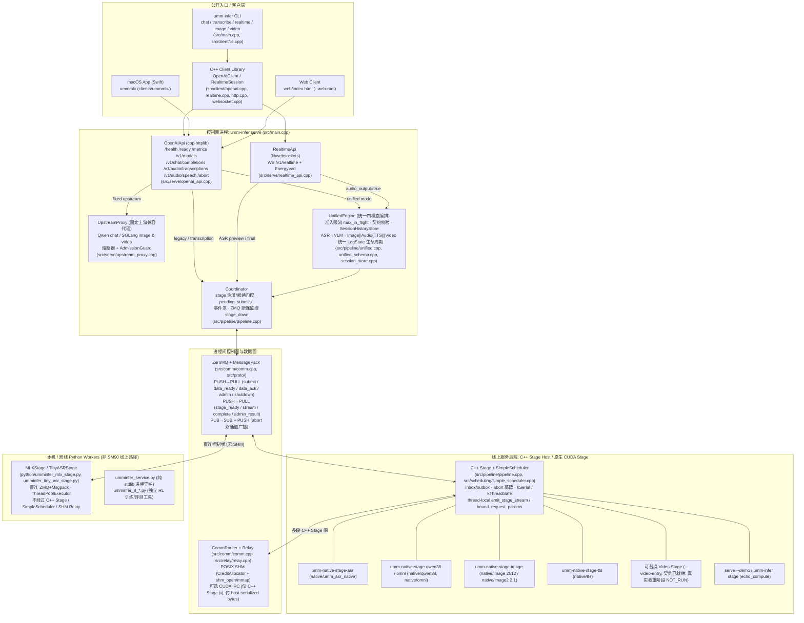

# ummInfer 权威架构与验证说明

> 本文档是 ummInfer 的单一权威架构文档，涵盖真实源码核对后的系统拓扑、端到端调用链（同步/流式、取消、错误、会话与资源生命周期）、本机轻量验证矩阵以及已记录的技术债边界。
> 代码锚点索引见 [docs/feature-map.md](feature-map.md)；模型支持矩阵与选型见 [docs/model-support.md](model-support.md)；阶段门控与规划见 [docs/roadmap.md](roadmap.md)。

---

## 1. 整体架构图

---

## 2. 关键调用链与生命周期

| 维度 | 真实代码路径与行为 | 关键源码定位 |
|---|---|---|
| **同步请求（非流式）** | `POST /v1/chat/completions` (`stream=false`) → 校验通过后 `submit_chat()` 调 `UnifiedEngine::submit()`（无音频直投 `vlm_stage`，有音频先投 `asr_stage`）或 `Coordinator::submit()`（分配 `req-N`）→ `while (!settled && !req.is_connection_closed()) wait_chat(id, 0.1)` 轮询等待 → `release_chat(id)` 清理记录并返回 JSON。`/v1/audio/transcriptions` 绕过 `UnifiedEngine` 直接走 `Coordinator::submit(..., entry_stage)`；`/v1/audio/speech` 复用 `UnifiedEngine::tts_stage_name()` 注册的 TTS stage，经 `AdmissionGuard` 准入后同步返回 `audio/wav` 或 `audio/pcm`（未注册 TTS stage 或固定上游模式返回 501）。 | `src/serve/openai_api.cpp:860-1228`, `1470-1530`; `src/pipeline/unified.cpp:172-257` |
| **流式请求（SSE / WS）** | **HTTP SSE**：`OpenAIApi` 分配 `http-N` 并注册 `SseSink` → `set_chunked_content_provider` 消费 `SseSink::pop()`。`Coordinator::run()` 单线程泵收到 `StreamMessage`/`CompleteMessage` → `UnifiedEngine::CallbackGate` → `handle_stream`/`handle_complete` 入 `dispatch_queue_` 串行化派发（避免重入死锁）→ `on_event` 推送到 `SseSink`。文本/图像/音频/视频共用统一 `UnifiedModality` 与 `LegState`（`pending`/`running`/`completed`/`failed`/`aborted`，可通过 `legs_snapshot()` 查询），图像（`image/png`/`jpeg`）、音频（`audio/wav`/`pcm`）与视频（`video/mp4`，单产物上限 48 MiB、单请求聚合上限 60 MiB）产物统一经 `slice_artifact_events` 按 `2 MiB` 分片并在 HTTP provider 线程做 base64 与末片 SHA-256。**流式 TTS**：`audio.stream=true` 且无 image/video 输出时，`handle_stream` 在 VLM delta 到达时调用 `drain_sentences_locked`（带异常保护，提交失败转为 `kLegError` 而不中断 VLM 或事件泵）按句切分（首句 8 codepoints，后续 48 codepoints，最多 32 个子 leg `id:tts:N`）边生成边推 `audio/pcm` `kArtifact`。**WebSocket**：`RealtimeApi` 在 `libwebsockets` 线程每 10ms `poll_sessions()` 消费 `partial_queue_` 与 `unified_queue_`，VAD 触发 `speech_started`/`speech_stopped`，`audio_output=true` 时把转写结果交给 `UnifiedEngine`。 | `src/serve/openai_api.cpp:396-600`, `1600-1790`; `src/pipeline/unified.cpp:440-590`, `980-1080`; `src/pipeline/unified_schema.cpp:319-400`; `src/serve/realtime_api.cpp:206-262`, `758-1093` |
| **取消与中止** | **触发源**：客户端断连（`req.is_connection_closed()` / `!out_sink.is_writable()` / WS `LWS_CALLBACK_CLOSED`）、超时（`timeout`）、barge-in（WS `on_speech_started`）、显式 `POST /abort {request_id, session_id}`（校验归属，不匹配返回 403）、进程退出（`Coordinator::stop()` 标记 `shutdown`）。**传播**：`UnifiedEngine::cancel_for_session` 在 `mu_` 内置 `cancel_requested=true`，收集所有已提交子 leg（`vlm_id` / `:image` / `:video` / `:tts*`），锁外逐个调 `Coordinator::abort` → `CoordinatorControlPlane::broadcast_abort` 通过 **PUSH（可靠有序）+ PUB（低延迟）双通道**广播 `AbortMessage` → `Stage` 的 `abort_thread_` 和 `run()` 写入 `SimpleScheduler::aborted_` 墓碑（保留 10 分钟，防 abort-before-submit 乱序）并清理 `pending_ops_` → 计算函数在安全边界检查 `AbortCheck` 抛 `RequestAborted`。未扇出的 `pending` 输出 leg（含 `video`）被 `cancel_requested` 阻断并转为 `aborted`；终态 `legs[]` 对已取消的 `image`、`tts`、`video` leg 均如实报告 `state: "aborted"`。 | `src/serve/openai_api.cpp:810-865`, `1635-1645`; `src/pipeline/unified.cpp:270-315`, `1110-1200`; `src/pipeline/pipeline.cpp:215-230`, `981-1016`; `src/comm/comm.cpp:535-557`; `src/scheduling/simple_scheduler.cpp:82-121`, `228-244` |
| **错误传播与容错** | **输入/准入错误**：HTTP 层校验返回 400（含未注册 `--image-entry`/`--tts-entry`/`--video-entry` 或 `stream=false` 请求混合输出）；`AdmissionGuard` 或 `UnifiedEngine` `max_in_flight` 满抛 `QueueFullError` 返回 `503 + Retry-After: 1`；固定上游代理带连续失败熔断器（`UpstreamProxy::check_circuit_breaker`）。**执行/进程错误**：Stage 计算抛异常 → `SimpleScheduler::emit_error` → `Stage::fail_request` 发 `CompleteMessage(success=false)`；Stage 进程崩溃 → `PushSocket` ZMQ monitor 捕获 `ZMQ_EVENT_DISCONNECTED` → `Coordinator::stage_down` 立即将归属该 stage 的 pending/running 请求置 `failed` 并清除 `ready_stages_`（使 `/ready` 变 503）。**可选输出 leg 隔离**：Image/TTS/Video 子 leg 提交失败、执行失败或超出产物字节上限均发 `kLegError` 但不中断主 VLM 终态；主请求在所有子 leg 结算后仍发 `kComplete` 并在 `legs[]` 报告各 leg 状态。 | `src/comm/comm.cpp:97-154`; `src/pipeline/pipeline.cpp:1018-1058`; `src/pipeline/unified.cpp:450-470`, `750-805`, `1110-1200`; `src/serve/upstream_proxy.cpp` |
| **会话与资源生命周期** | **会话**：默认 `session_id` 仅作事件分组标签与取消归属边界；`--session-history` 开启进程内 `SessionHistoryStore`（默认 256 会话 × 8 轮 / 16384 字符三级淘汰，仅在 `kComplete` 成功时入库，取消/失败不入库，重启清空）。**请求记录**：`UnifiedEngine::release` 清理 `records_`、`child_to_unified_`、`admission_`（并刷新 `unified_admission` 队列深度指标），级联 `Coordinator::release` 所有子 id（含 `:vlm`/`:image`/`:tts*`/`:video`）。**回调退场**：`UnifiedEngine::~UnifiedEngine` 通过 `CallbackGate::retire()` 等待活跃回调退出并将后续事件无缝回退到前序 sink。**Relay 信用与内存**：`ShmPutOperation` 析构自动 `shm_unlink` 并释放 `CreditAllocator` 信用；`Stage::reaper_thread_` 按 `transfer_timeout_ms`（默认 30s）回收无 ACK 传输；`CudaIpcPutOperation` 在被放弃时退休 device slot 并将 relay 标为不健康，防止复用接收端仍在映射的显存。 | `src/pipeline/session_store.cpp:17-71`; `src/pipeline/unified.cpp:41-119`, `380-430`; `src/relay/relay.cpp:80-120`, `226-286`, `451-551`; `src/pipeline/pipeline.cpp:315-346` |

---

## 3. 本机轻量构建与测试验证矩阵

> 环境：macOS 25.3.0 (ARM64), Zig 0.16.0, AppleClang 21.0.0, CMake, Swift, Python 3.13.7（系统 Python 无 `msgpack`/`pyzmq`/`mlx`/`websockets` 第三方包），无 NVIDIA CUDA GPU。
> 规则：本矩阵仅记录本机无 GPU 轻量构建与测试；真实大模型与 SM90 线上验证均明确标为 `NOT_RUN`。

| 序号 | 套件 / 构建目标 | 命令 | 状态 | 说明 |
|---|---|---|---|---|
| 1 | 控制面 Debug 构建 | `zig build -Ddeps-prefix=/opt/homebrew -Dcurl-prefix=/opt/homebrew/opt/curl` | **PASS** | 退出码 0，产出 `zig-out/bin/umm-infer` |
| 2 | 控制面 ReleaseFast 构建 | `zig build -Doptimize=ReleaseFast -Ddeps-prefix=/opt/homebrew -Dcurl-prefix=/opt/homebrew/opt/curl` | **PASS** | 退出码 0 |
| 3 | C++ 统一编排契约测试 | `zig build test -Ddeps-prefix=/opt/homebrew -Dcurl-prefix=/opt/homebrew/opt/curl` | **PASS** | 退出码 0，`unified_contract_test` 全套（含文本/图像/音频回归及新视频统一契约：`pending/running/completed/failed/aborted`、取消、会话归属、资源清理、SSE 5 MiB 分片重组）通过；**仅验证测试 Stage 契约，不计作真实生视频** |
| 4 | HTTP 与进程生命周期冒烟 | `zig build smoke -Ddeps-prefix=/opt/homebrew -Dcurl-prefix=/opt/homebrew/opt/curl` | **PASS** | 退出码 0；demo/external stage/disconnect/SIGTERM/CLI 全部通过 |
| 5 | 客户端 CLI 解析与 URL 策略边界检查 | `python3 -I tests/client_boundary_e2e.py zig-out/bin/umm-infer --skip-real` | **PASS** | 退出码 0；`chat_cli_parsing`、`serve_stage_parsing`、`url_policy` 三项 PASS，真实回归按 `--skip-real` 跳过 |
| 6 | 功能映射锚点校验 | `python3 -I tools/check_feature_map.py` | **PASS** | 退出码 0；逐行与基线 commit 核对通过 |
| 7 | 离线多模态基准契约测试 | `python3 -I tests/multimodal_benchmark_test.py` | **PASS** | 退出码 0；70 用例回放与指标一致性通过 |
| 8 | 黑盒门禁自检 | `python3 -I tests/blackbox_integration.py --self-check` | **PASS** | 退出码 0；`log_cap`、`timeout`、`orphan` 三项进程组清理自检通过 |
| 9 | macOS Swift 客户端测试 | `(cd clients/ummmlx && swift test)` | **PASS** | 退出码 0；71 tests, 0 failures（含 `video/mp4` 多分片产物重组） |
| 10 | `native/stage_cli` host 构建与 ctest | `cmake -S native/stage_cli -B /tmp/umminfer-stage-host -DCMAKE_PREFIX_PATH=/opt/homebrew && cmake --build /tmp/umminfer-stage-host -j && ctest --test-dir /tmp/umminfer-stage-host --output-on-failure` | **PASS** | 退出码 0；`tts_tail_trim_test` 1/1 通过 |
| 11 | `native/` 根 host 库构建 | `cmake -S native -B /tmp/umminfer-native-root -DCMAKE_PREFIX_PATH=/opt/homebrew && cmake --build /tmp/umminfer-native-root -j` | **PASS** | 退出码 0；`libqwen38_host.a`、`libumm_asr_host.a` 编译通过 |
| 12 | `native/{omni,tts,image,image2}` host 构建与 ctest | `cmake -S native/<kind> -B /tmp/umminfer-<kind>-host -DCMAKE_PREFIX_PATH=/opt/homebrew && cmake --build ... -j && ctest ...` | **PASS** | 4/4 子项目 host 测试恢复并全部通过（`omni_host_tests`、`tts_host_tests`、`image_host_tests`、`image2_host_tests`；`tts_host_tests` 无权重目录时跳过 `test_tokenizer` 并打印 `SKIP`） |
| 13 | MLX Stage 结果元数据单测 | `python3 -I tests/mlx_stage_result_test.py` | **FAIL (环境缺失)** | `ModuleNotFoundError: No module named 'msgpack'` |
| 14 | Python 端到端真实模型套件 | `tests/client_boundary_e2e.py`（真实 chat/ASR 部分）及 `tests/{realtime_contract_e2e,realtime_client_contract_e2e,client_retry_e2e,mac_unified_validation}.py` | **NOT_RUN** | 需要真实 MLX/TinyASR 模型及 `mlx`/`msgpack`/`zmq`/`websockets` 依赖 |
| 15 | CUDA IPC / 原生 CUDA stage / 真实视频生成后端 / SM90 线上与压测 | `zig build cuda-bench -Dcuda`, `native/*` `-DUMM_*_CUDA=ON`, 真实视频 Stage/上游生成, `tests/{sm90_service_live,full_duplex_live,full_duplex_l2_live,soak_native,concurrency_load,multimodal_benchmark}.py` | **NOT_RUN** | 需要 Linux CUDA 主机、真实模型权重或真实视频上游；本机不执行，测试 Stage 桩不计作真实生视频验收 |

---

## 4. 已知技术债与治理边界

> 本轮已完成修复：
> - **P1**：`UnifiedEngine::settle_output_leg_locked` 取消 TTS leg 误报 `failed` 修复与回归测试（`src/pipeline/unified.cpp`、`tests/unified_contract_test.cpp`，已做 Red/Green 验证）；
> - **P1**：`UnifiedEngine::handle_stream` 中 `drain_sentences_locked` 流式 TTS 句切分提交异常边界保护与回归测试（`src/pipeline/unified.cpp`、`tests/unified_contract_test.cpp`，已做 Red/Green 验证）；
> - **P1**：恢复 `native/{omni,tts,image,image2}` CPU host 单元测试并删除 `CMakeLists.txt` 中指向已删除测试/工具的失效 target（已做 Red/Green 验证）；
> - **P3**：移除私有死代码 `UnifiedEngine::SessionTurn`（`include/umminfer/pipeline/unified.hpp`）。

剩余未在当前范围改动的架构与整洁性债务（后续优先级见 [docs/roadmap.md#next-priorities](roadmap.md#next-priorities)）：

- **P2 · `request_id` 命名空间与前缀硬编码耦合**：非流式 chat 由 `Coordinator` 分配 `req-N`（`src/pipeline/pipeline.cpp:748`），流式 chat 由 `OpenAIApi` 分配 `http-N`（`src/serve/openai_api.cpp:1532`），`RealtimeApi` 分配 `realtime-N`（`src/serve/realtime_api.cpp:428`）；`RealtimeApi::drain_unified`（`src/serve/realtime_api.cpp:1084`）依赖 `request_id.rfind("http-", 0) != 0` 避免误释放 HTTP 请求。
- **P2 · HTTP 边界与 `unified_schema` 校验分叉**：`src/serve/openai_api.cpp:309,346` 限制统一 chat 最多 1 个 text part，`src/pipeline/unified_schema.cpp:105-139` 不限制；`src/serve/openai_api.cpp:447` 允许 `image.output_format="jpeg"`，而原生 `image_stage` 仅产出 PNG。
- **P2 · 指标记账小缺口**：`src/pipeline/unified.cpp:706-709` 取消竞态完成分支未调 `record_primary_leg("aborted")`；`src/pipeline/unified.cpp:331-339` 在 `release()` 移除未终态记录时未刷新 `unified_admission` 队列深度指标。
- **P3 · 元数据透传与未来多格式扩展性**：`src/pipeline/unified.cpp:918-919`（`emit_tts_chunk_locked`）当前写入固定的 `sample_rate=24000`、`channels=1`；现有原生路径（`native/stage_cli/tts_stage.cpp`、`stage_common.cpp`）本身也仅产生与接受该格式，当前无输出错误，后续接入多采样率/多声道 TTS 后端时再改为从 chunk 元数据透传。
- **P3 · 有意保留项与测试覆盖边界**：
  - `include/umminfer/pipeline/unified.hpp:214-224` 两组等价公开访问器（`image_output_enabled`/`image_enabled`、`tts_output_enabled`/`tts_enabled`）为保持公开头文件兼容而保留；
  - `native/{omni,qwen38}/{stb_image.h,unicode_ranges.hpp}` 仅为 2~3 行 `#include "../common/..."` 转发壳，为兼容各引擎独立 include 路径而保留；
  - `src/proto/messages.cpp:40-81` 的旧版 `DataRef.header` 宽松 Base64 解码器接受无填充（如 `Zg`）与非规范尾位输入，为保持对旧发送端的公开协议兼容而保留，未替换为严格的 `util::base64_decode`；
  - `src/main.cpp:154` 与 `native/stage_cli/main.cpp:43` 的 15 行 `ensure_ipc_parent` 位于两个独立可执行文件入口，避免为少量代码引入额外公共头耦合；
  - `SimpleScheduler` 批处理/墓碑、流式 TTS 句切分与字节上限中止、跨会话 `cancel_for_session` 403 及 `/v1/audio/speech` 控制面契约均已在 `tests/unified_contract_test.cpp` 覆盖；真实 TTS Stage 与 SM90 GPU 端到端验证仍为 `NOT_RUN`。
